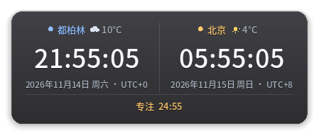

# 双时区时钟

Windows 11 桌面上的一个小窗口，并排显示两个时区，可选天气和番茄钟。默认是都柏林和北京。夏令时按 Windows 自己的时区数据计算。

一个 64 位 exe，不需要安装运行库，也不需要管理员权限。



## English

Dual Zone Clock is a small borderless desktop widget for Windows 11. It shows two clocks side by side (Dublin and Beijing by default), optional current weather, and a pomodoro or countdown. Daylight saving follows Windows time-zone data. Download the portable exe from [GitHub Releases](https://github.com/tom2023n/dual-zone-clock/releases). If SmartScreen appears, choose **More info** then **Run anyway** — the file is unsigned. Build on Linux with MinGW-w64: `./build.sh`. Licensed under MIT. Weather data is from [Open-Meteo](https://open-meteo.com) (CC BY 4.0).

## 功能

- 两个时钟并排：名称、24 小时制时间、日期、星期、UTC 偏移。都柏林含夏令时，北京全年 UTC+8。
- 拖动放置，位置和设置记在 `%APPDATA%\DualZoneClock\settings.json`。
- 右键菜单（中文）：改名称、选时区、选城市、始终置顶或留在桌面、大小和透明度滑块、显示秒、开机启动。
- 天气：地名旁显示当前温度和图标。数据来自 Open-Meteo，大约每 20 分钟在后台更新。断网时保留上次结果，没有结果就显示 `--`。
- 番茄钟和倒计时：专注、短休息、长休息，或按分钟、按某个时刻倒计时。结束时播放系统提示音，并在通知区域弹出提示。

## 下载

从 [Releases](https://github.com/tom2023n/dual-zone-clock/releases) 下载 **v1.0.0**：

- `DualZoneClock-win64.zip`：压缩包，里面是 exe 和这份说明
- `DualZoneClock.exe`：直接双击运行

只支持 64 位 Windows 11。不需要安装 .NET 或其他运行库。

### SmartScreen

第一次运行时，Windows 可能会弹出蓝色提示「Windows 已保护你的电脑」。点「更多信息」，再点「仍要运行」。这是因为程序没有购买代码签名，不是因为缺少组件，也不是安装包损坏。

## 使用

时钟第一次出现在屏幕工作区的右上角。按住左键拖走，松手后位置会记住。

通知区域有托盘图标。左键单击：如果时钟被拖出屏幕，会把它拉回来。右键打开和时钟上一样的菜单。再双击一次 exe 不会开出第二个窗口。

计时进行时，时钟底部有一条剩余时间。单击这条可以暂停或继续。

### 右键菜单

| 菜单 | 作用 |
| --- | --- |
| 时钟 1 / 时钟 2 → 修改名称 | 改这一侧显示的名字 |
| 时钟 1 / 时钟 2 → 选择时区 | 从 Windows 时区列表里另选，可以搜索 |
| 时钟 1 / 时钟 2 → 选择城市… | 按城市名搜索天气地点。默认都柏林和北京 |
| 始终置顶 | 浮在其他窗口上面 |
| 留在桌面 | 停在桌面上，普通窗口会盖住它。这是默认 |
| 大小与透明度… | 大小 50%–300%，透明度 20%–100%，拖动时马上预览 |
| 显示天气 | 开关地名旁的温度和图标 |
| 温度单位 | 摄氏 °C 或华氏 °F |
| 显示秒 | 开或关。时间始终是 24 小时制 |
| 番茄钟 → 开始专注 | 默认 25 分钟。四个专注后是 15 分钟长休息，中间是 5 分钟短休息 |
| 番茄钟 → 自定义倒计时… | 按分钟倒计时 |
| 番茄钟 → 倒计时到指定时间… | 倒计时到今天或明天的某个时刻 |
| 番茄钟 → 暂停 / 继续 / 停止 | 控制正在走的计时 |
| 番茄钟 → 时长设置… | 改专注、短休息、长休息和长休息间隔 |
| 开机启动 | 登录后自动打开。写在当前用户的启动项里，不需要管理员 |
| 重置位置 | 拖出屏幕外时放回右上角 |
| 退出 | 关闭程序 |

都柏林冬天是 `UTC+0`，夏令时是 `UTC+1`。北京全年是 `UTC+8`。

## 设置文件

`%APPDATA%\DualZoneClock\settings.json`

里面有窗口位置、透明度、大小比例 `scale`（100 是标准大小）、天气开关、温度单位、番茄钟时长，以及两个钟的名称、时区、经纬度和上次天气。以前保存的「小 / 标准 / 大」会自动换成 86%、100%、126%。换电脑时可以拷走这个文件。

## 从源码构建

在 Linux 上安装 MinGW-w64，然后在仓库根目录运行：

```bash
sudo apt install g++-mingw-w64-x86-64 binutils-mingw-w64
./build.sh
```

生成 `build/DualZoneClock.exe`。不需要打开窗口的自测：

```bash
wine build/DualZoneClock.exe --self-test selftest.txt
```

`build/` 已在 `.gitignore` 里，不要把 exe 提交进源码仓库。发布时把 exe 和 zip 放到 GitHub Releases。

## 许可与致谢

程序源码采用 [MIT License](LICENSE)，版权归 tom2023n。

界面中文使用随程序嵌入的 Noto Sans SC 子集，授权是 SIL Open Font License 1.1，全文在 `assets/fonts/OFL.txt`。字体版权归 Adobe 与 Noto 项目。嵌入的是裁剪过的字形，字体内部名称改为 DualZone Sans。

天气数据来自 [Open-Meteo](https://open-meteo.com)，采用 [CC BY 4.0](https://creativecommons.org/licenses/by/4.0/) 授权。
